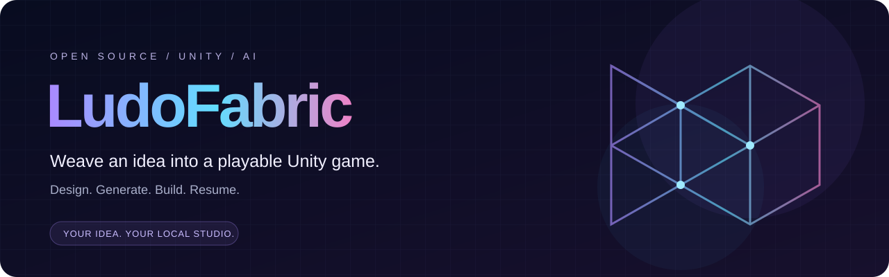
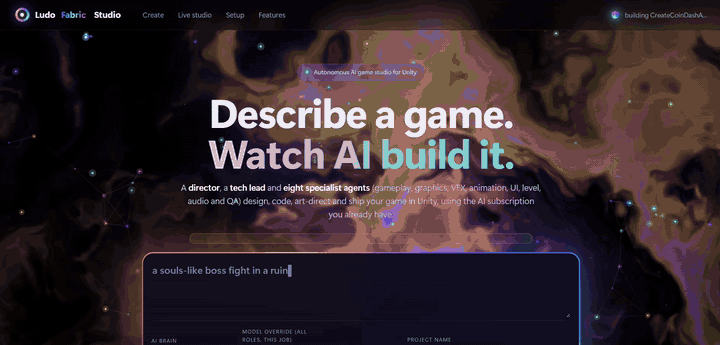
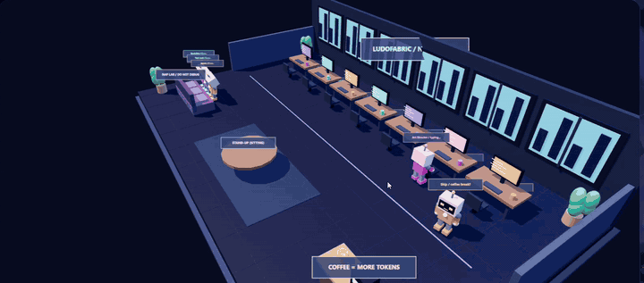
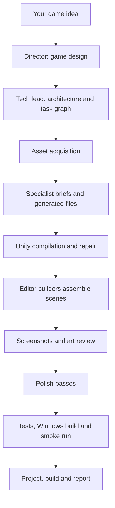

<div align="center">



**An open-source AI game studio for Unity.**

Build new games. Improve existing Unity projects. Resume across interruptions.

[](LICENSE)
[](#requirements)
[](#quick-start)
[](#project-status)
[](https://github.com/Aravindraj93/LudoFabric/actions/workflows/tests.yml)

[Get started](#quick-start) · [How it works](#how-it-works) · [Recovery](#built-to-resume) · [Contribute](CONTRIBUTING.md)

</div>

---

## See LudoFabric in action

### From your idea to the live studio



A recorded walkthrough of the local dashboard: describe a game, follow the pipeline, and inspect
the generated project documents. This preview shows the development workflow, not a finished game.

### A little office for a big idea



The interactive 3D office turns pipeline stages into an animated scene. It is a stage visualization,
not a display of actual model activity or hidden reasoning.

## Your idea, a coordinated studio

LudoFabric turns a game description into a structured Unity development workflow. A director shapes
the design, a tech lead creates the task graph, and specialist roles generate gameplay, graphics,
VFX, animation, UI, level, audio, and test code. Unity runs locally to compile scripts, assemble
scenes, capture screenshots, and produce a Windows player. Bring an existing project to make focused
changes, or create an isolated revision copy that preserves the source.

This is an **experimental developer tool**. Generated code and games need human review and playtesting.
The goal is a transparent, recoverable workflow you can inspect and improve.

| Capability | What you get |
|---|---|
| **Prompt → design → plan** | Structured game design, architecture, and dependency-aware tasks |
| **Specialist roles** | Focused briefs and complete file outputs for each area of the game |
| **Local Unity execution** | Editor builders, compilation checks, scene assembly, Windows builds |
| **Repair loops** | Compiler and runtime errors fed back into the generation workflow |
| **Visual feedback** | Screenshot-based art reviews and configurable polish passes |
| **Resumable work** | Disk checkpoints, cached responses, and journaled task outputs |
| **LangGraph orchestration** | SQLite checkpoints, durable execution identity, classified failures, and bounded retries |
| **Existing-project development** | Project profiling, targeted changes, recorded code backups, and isolated revision copies |
| **Recent projects** | Saved local paths, most-recently-opened ordering, and direct reopening across restarts |
| **Platform selection** | Windows, Android, iOS, macOS, Linux, and WebGL build adapters with module checks |
| **Efficient generation** | Shared contracts, focused context, template briefs, exact patches, budgets, and measured timings |
| **Live dashboard** | Progress, documents, logs, screenshots, and an interactive 3D office |
| **Multiple backends** | Codex, Claude Code, Gemini CLI, Qwen Code, OpenAI-compatible APIs |
| **Asset sourcing** | Poly Haven and optional Sketchfab integration with generated credits |

The 3D office visualizes pipeline stages; it does not display actual model activity or hidden reasoning.

## Tested on an existing game

LudoFabric has been exercised on an isolated copy of a **ten-level Unity 6 URP project** with an
additional Guardian benchmark scene. Using the selected Codex model, it planned, generated, compiled,
and executed a read-only scene-audit command in two model requests.

- All **ten enabled levels** and **eleven scene assets** had valid references.
- The game's existing **ten-level native gameplay regression** passed.
- The Guardian checks passed **479 benchmark assertions** and **147 crown-framing assertions**.
- Original source files and the copied authored scene-file hashes remained unchanged.

The tool itself passes **127 local automated tests**. A separate diagnostic project also passed real
Unity scene creation, screenshots, a Windows player build, and a player smoke run. These results
verify the listed workflows; visual polish, game completion, device performance, and store readiness
still require their own acceptance checks. See [verification details and release limits](docs/RELEASE_READINESS.md).

## Quick start

### Requirements

- **Windows** for the current full Unity workflow.
- **Python 3.11+**. Local regression checks have been run with Python 3.13.
- **Unity 6**, an activated license, and Windows build support. Setup and bridge compilation have
  been verified locally with **6000.5.0f1**; other versions may need compatibility fixes.
- One supported AI backend, with its CLI installation/login or API configuration. Account eligibility
  and usage limits depend on the provider.

### 1. Install

```powershell
git clone https://github.com/Aravindraj93/LudoFabric.git
cd LudoFabric
py -3 -m venv .venv
.\.venv\Scripts\python.exe -m pip install -r requirements.txt -c requirements-lock.txt
Copy-Item .env.example .env
```

### 2. Configure

Edit `.env` and point to your installed Unity Editor:

```dotenv
LLM_BACKEND=codex
UNITY_EDITOR=C:\Program Files\Unity\Hub\Editor\6000.5.0f1\Editor\Unity.exe
MODEL_ORCHESTRATOR=
MODEL_CODER=
MODEL_VISION=
```

For the default Codex backend, install the official CLI if needed, then sign in:

```powershell
npm install -g @openai/codex
codex login
```

Use a recent CLI supporting `exec --ignore-user-config`. LudoFabric retains CLI authentication while
isolating inherited app model, plugin, and MCP settings. Empty model fields use the CLI default.
Choose explicit models only when supported by your account.

If a model works in VS Code but fails here, compare the CLI executable and version: a bundled
extension binary can differ from the current standalone CLI. GPT-6.1 Sol has been verified with
official Codex CLI **0.172.0**. LudoFabric prefers a standalone native CLI installed under the user's
npm directory, or a project-local `.local-tools/codex` installation, over a VS Code binary on PATH.
`CODEX_BIN` remains an explicit override. On Windows, this optional local install is detected automatically:

```powershell
npm install --prefix .local-tools/codex --no-save @openai/codex@0.172.0
```

### 3. Launch

```powershell
.\.venv\Scripts\python.exe main.py web
```

Open **http://127.0.0.1:8765**, test your AI provider, confirm Unity, and enter a game idea.
Start with **Design & plan**, review the output, then select **Build in Unity** on the saved project.

> Keep the target project closed in Unity while LudoFabric runs it in batch mode. Use a dedicated
> project: generated C# Editor builders execute on your computer. Keep the server on localhost;
> it is not designed for public hosting or untrusted users.

<details>
<summary><strong>A small first game to try</strong></summary>

```text
Create a simple 3D coin collection game for Windows.
Use a flat arena, a capsule player, and 10 yellow coins.
Move with WASD or arrow keys and use a fixed overhead camera.
Collect coins by touching them. Show Coins: X/10 and You win! when finished.
Press R to restart. Use Unity primitives and solid-color materials only.
No downloaded assets, enemies, audio, or additional packages.
Create one playable scene and keep the code small and maintainable.
```

</details>

## How it works



Agents generate **static Editor builder methods**, then LudoFabric invokes Unity with `-executeMethod`.
The installed C# bridge supplies URP setup, scene utilities, screenshot capture, and player builds.
No automated clicking in the Unity Editor is required.

For compatibility with existing projects, the Python package remains `gameagent` and the C# namespace
remains `GameAgent.Bridge`. The product is **LudoFabric**.

## Choose platforms: Windows, Android, iOS, macOS, Linux, WebGL

Tick platforms under **Build for** in the dashboard (or **All**), or pass `--platforms`:

```powershell
python main.py run "a cozy match-3 garden game" --project C:\UnityProjects\Garden --platforms windows,android,ios
python main.py resume --project C:\UnityProjects\Garden --platforms all   # adds platforms; rebuilds only
```

- The director and specialists are told the targets. Mobile targets require touch controls, safe-area UI and
  mobile-friendly budgets.
- Each platform needs its **Unity Hub build module**. Missing modules are detected and reported per platform; the
  other platforms still build.
- **Windows**: `.exe`, smoke-run locally. **Android**: `.apk`, or `.aab` with `LF_ANDROID_FORMAT=aab`.
  Android builds are debug-signed unless `LF_ANDROID_KEYSTORE`, `LF_ANDROID_KEYSTORE_PASS`, `LF_ANDROID_KEY_ALIAS`
  and `LF_ANDROID_KEY_ALIAS_PASS` are set. The bridge reads these from environment variables rather than
  command-line arguments. **iOS** output is an Xcode project; compiling, signing and installing need macOS,
  Xcode and an Apple developer account. The macOS, Linux and WebGL adapters target their respective outputs.
- The Windows build path has been verified locally. Other platform adapters are implemented and unit-tested;
  real builds and target-device behavior remain unverified in this tool's release checks. Selecting a mobile
  target does not by itself add missing touch controls or establish store compliance.

## Safety

- Generated C# is scanned before it is written (`CODE_POLICY=strict|warn|off`, default `strict`). The scan blocks:
  process and shell launch, the registry, native or dynamic code, network access from Editor code, file access by
  absolute or `..` paths, user folders, and exiting the Editor. Violations go back to the model for a rewrite. This
  is a guardrail, not a sandbox; use a dedicated project or VM.
- The dashboard requires a per-session token for every state-changing request, and rejects cross-site origins and
  non-localhost `Host` headers.

## Built to resume

AI usage limits should pause a project, not erase it.

```text
UnityProjects/
├── CoinDash/                  Unity project
└── CoinDash.agent/
    ├── state.json             Request, design, plan and progress
    ├── pending_call.json      Pending request during an interruption
    ├── task_outputs/          Generated task outputs for replay
    ├── llm_logs/              Prompts, responses and response cache
    ├── unity_logs/            Setup, compile, build and player logs
    └── REPORT.md              Report when the pipeline completes
```

Select your project and **Resume**, or use **Open project by path** with its full folder path.
Keep the Unity project and adjacent `.agent` folder together when moving or backing up work.

### Your projects, one selection away

Use **Recent projects** under the Create controls to reopen a saved project. LudoFabric remembers
the full local path and last-opened time, puts recent work first, and avoids duplicate entries for the
same path. Open another location with **Open project by path**; it will be remembered for next time.
Recent-project metadata stays in the local, Git-ignored `.studio/` directory.

Previous job failures remain in project history. The dashboard labels historical failures separately
from current server activity and lets you **Dismiss** their notice without erasing the error record.

By default, usage limits save progress and stop the job. Reopen the tool and resume after your
account resets. The suggested retry delay is configurable, not live quota telemetry. Closing a browser
leaves the Python server running; closing the server stops execution. Automatic restart scheduling
is not implemented. An unfinished model response may need to be requested again.

```powershell
python main.py resume --project "C:\UnityProjects\CoinDash"
```

An arbitrary Unity project without a LudoFabric checkpoint cannot recover an original plan, but it can
receive **change requests** (below).
See [recovery details](docs/RECOVERY.md).

### Improve a shipped game

Click **Improve this game** on a shipped project, describe your feedback, and choose **Design & plan**.
LudoFabric snapshots and inspects the existing project, then plans targeted changes in a separate copy.
Review the plan and choose **Build in Unity**. Revision jobs resume from their own checkpoints.
You can also supply the **Source project** path directly. See [revision workflow and limits](docs/REVISIONS.md).

## Upgrade a finished game, or any existing Unity project

For changes directly in the selected project, use **Apply change**. For a separate project copy that preserves the source, use **Improve this game** above. Change rollback covers recorded code edits; it is not a complete project restore.

```powershell
# A game LudoFabric finished, or a Unity project you built in VS Code / Rider / the Editor
python main.py change "Add a double jump with a dust puff and show best time on the win screen" --project "D:\Games\My Game"
python main.py rollback --project "D:\Games\My Game" --change c001
```

In the dashboard, use **Open project by path** or **Recent projects**, then **Apply change**.

- The project is profiled deterministically: Unity version, render pipeline (URP, HDRP or Built-in), input system,
  packages, scenes, namespaces, assemblies and tests. External projects are told their real environment instead of
  LudoFabric's URP defaults.
- One planning call sees the profile, the file list and keyword-retrieved snippets, not the whole source.
  It produces 1–6 tasks that edit existing files with exact patches.
- Every touched file is backed up to `<Project>.agent/changes/<id>/backup` before it is written. Rollback restores it.
- Verification fits the project: plain batch compile with bounded repair, direct execution of generated Editor
  methods, and EditMode tests when the project has them. For LudoFabric games already shipped, the Windows build and
  smoke run are also repeated. Without a configured Unity Editor the change is reported as `applied_unverified`.
- External projects never receive the LudoFabric bridge or starter, and their packages are not modified. A sibling
  `<Project>.agent` folder holds checkpoints, backups and logs.

## Free 3D assets

The director and planner receive the available-source settings. The planner requests models, HDRIs and
textures; deterministic Python downloaders acquire them before specialists generate scene code. Agents
receive the resulting registry's exact paths, not invented download URLs.

- **Poly Haven:** CC0 props, nature, HDRIs and PBR textures; no API token needed.
- **Sketchfab:** optional `SKETCHFAB_API_TOKEN` for downloadable models, including characters and stylized
  assets where available. Automatic downloads accept CC0 and CC-BY. CC-BY-SA needs explicit
  `ALLOW_SHAREALIKE_ASSETS=1`; review ShareAlike obligations before distributing modified assets.
- **Use in Unity:** LudoFabric builders receive scaling, material, collider and animation guidance.
  External projects receive their own pipeline's guidance, without unavailable SceneKit helpers.
  External model downloads require an existing supported glTF importer; packages are not installed silently.
- **Attribution:** downloaded assets are recorded in `Assets/ThirdParty/CREDITS.md`. Include required
  attribution and applicable license information with distributed builds; that release check remains manual.
- **Missing models:** reported as unavailable. A fallback is not evidence of a completed final-art requirement.
  `procedural_only` forbids new downloads even when a model returns asset requests or an old plan is resumed.

For example: “Create a forest exploration game using free licensed trees, rocks and wooden props. Use
Poly Haven where suitable, retain attribution, and report missing assets rather than claiming final art.”

Asset routing and prompt tests use mocks; live catalog availability, downloads and Unity imports are not
verified by those tests. Change rollback restores generated code; downloaded libraries and their registry
are retained rather than removed automatically.

## Command line

```powershell
# Design and plan without Unity
python main.py design "a cozy fishing game on a small island"

# Complete pipeline
python main.py run "a small coin collection game" --project C:\UnityProjects\CoinDash

# Search free assets
python main.py find-asset "wooden barrel" --kind model

# Dashboard without opening a browser
python main.py web --no-browser --port 8765
```

Use the virtual environment's Python executable if it is not activated.

## Choose your AI backend

| `LLM_BACKEND` | Connection |
|---|---|
| `codex` | Official Codex CLI with its existing login |
| `claude` | Claude Code CLI with its own login |
| `gemini` | Gemini CLI with its own login |
| `qwen` | Qwen Code CLI with its own login |
| `openai` | OpenAI Responses API with an API key |
| `chat` | OpenAI-compatible Chat Completions endpoint, including local services |

CLI authentication stays managed by the CLI. API mode reads keys from your local environment.
Selected prompts, project context, and screenshots go to your chosen provider. Logs and checkpoints
may contain private code and prompts; review them before sharing. LudoFabric is not affiliated with
Unity or these AI providers.

In the dashboard, choose an AI provider and enter a **Model override** for all roles in one job.
Under **Setup → Models**, optionally choose separate design/planning, coding, and screenshot-review
models. Save settings to retain these choices separately for each provider. **Test** checks the exact
entered model through that provider's login or API configuration; it does not verify image support
or Unity code quality. Leave a field empty to use the provider default.

Codex suggestions come from its local model cache and may be stale or belong to another surface.
All providers accept custom model IDs; a suggestion is not a guarantee of subscription access.
Use an image-capable model for screenshot review, or set visual polish rounds to zero.
Explicit model choices receive a minimal access check before a job starts, across all providers.
Successful checks are reused for five minutes. These small requests use the selected provider's
allowance; unavailable models are rejected before game tasks run. Known-rejected Codex models are
removed from cache suggestions, but you can enter and retest an ID if account access changes.

See [`.env.example`](.env.example) for CLI model selection, context budget, polish rounds, timeouts,
asset settings, and quota-pause behavior.

## Project status

**Available:** local dashboard and CLI, recent-project paths, LangGraph recovery, existing-project
changes, isolated revisions, project locks, generation/repair/polish loops, and selectable build targets.

**Verified locally:** 127 automated tests; live Codex generation of an existing-project diagnostic;
Unity 6000.5.0f1 compilation, scene builders, screenshot capture, Windows build/smoke checks; and the
existing-game regressions described above. These checks do not establish reliable completion for every
game or provider. This release remains an **experimental developer preview**.

See [efficiency and reliability](docs/EFFICIENCY.md) for the implemented tool improvements and next batches.
The [Coin Dash campaign reference upgrade](examples/coin-dash-campaign/README.md) exercises reusable data,
progression, runtime checks, and a Windows build without prescribing that genre for other projects.

**Not yet shipped:** packaged Windows app, cloud workers, automatic restart scheduling, on-device testing for mobile
builds, or a real Unity run of the Android/iOS build path (implemented and unit-tested only). Store readiness and
approval require separate implementation and validation.

### Known limits

- Screenshot reviews cannot judge game feel, target-device performance, or balance.
- Rigged character and animation availability vary; Poly Haven primarily supplies static assets.
- VFX Graph and Shader Graph authoring are limited; effects generally use generated code/shaders.
- Packages and APIs vary across Unity releases; inspect Unity logs when setup fails.
- Downloaded assets keep their own licenses and attribution/share-alike obligations.
- Provider models, CLI flags, authentication, and usage allowances can change.

## Roadmap

- [x] Save requests before AI calls and write checkpoints atomically
- [x] Replay interrupted production writes and reuse completed responses
- [x] Resume saved projects by path
- [x] Recent projects with persistent local paths and direct selection
- [x] Targeted existing-project changes and isolated source-copy revisions
- [x] Read installed Unity package compatibility requirements
- [x] Shared API contracts, focused context, and optional deterministic briefs
- [x] Dependency-aware task checkpoints and protection for edits made during generation
- [x] Safe exact-match patches, budgets, and per-project efficiency measurements
- [x] Optional reusable campaign data/save foundation with a tested reference upgrade
- [ ] Validate and publish a complete reproducible reference game
- [x] LangGraph engine with SQLite checkpoints, failure classification and bounded recovery ([migration notes](docs/MIGRATION.md))
- [x] Persistent token/cost budgets, per-agent usage, cooperative cancellation (`POST /api/jobs/cancel`)
- [x] Keyword retrieval and resolved-error memory for repairs; deterministic screenshot gate; evidence-based maturity
- [ ] Durable background job queue
- [ ] Windows app using the same dashboard and worker
- [x] Selectable platform adapters, including Android APK/AAB and environment-based signing configuration
- [ ] Real non-Windows build validation, device checks, and store-release verification
- [ ] Optional remote Unity workers and downloadable artifacts

See [architecture notes](docs/ARCHITECTURE.md) for the web, Windows, and cloud direction.

## Contribute

Bug reports, Unity compatibility fixes, tests, and small reproducible game examples are welcome.
Read [CONTRIBUTING.md](CONTRIBUTING.md) and [SECURITY.md](SECURITY.md).

```powershell
python -m unittest discover -s tests -v
```

Regression tests need no Unity installation or paid model calls. GitHub CI runs this suite, not
licensed Unity builds or provider-account checks.

## License and acknowledgements

LudoFabric source uses the [MIT License](LICENSE). Bundled Three.js files retain their upstream
MIT notice; see [third-party notices](THIRD_PARTY_NOTICES.md). Unity, AI services, and downloaded
assets have their own terms and licenses; this repository's license does not relicense them.

---

<div align="center">See the plan. Inspect the code. Keep building.</div>
