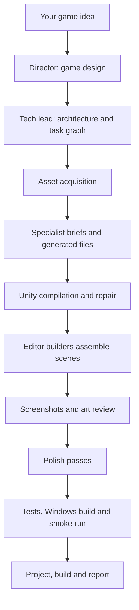

<div align="center">


**An open-source AI game studio for Unity.**

Describe a game. Follow the plan. Build locally. Pick up where you left off.

[](LICENSE)
[](#requirements)
[](#quick-start)
[](#project-status)
[](https://github.com/Aravindraj93/LudoFabric/actions/workflows/tests.yml)

[Get started](#quick-start) · [How it works](#how-it-works) · [Recovery](#built-to-resume) · [Contribute](CONTRIBUTING.md)

</div>

---

## Your idea, a coordinated studio

LudoFabric turns a game description into a structured Unity development workflow. A director shapes
the design, a tech lead creates the task graph, and specialist roles generate gameplay, graphics,
VFX, animation, UI, level, audio, and test code. Unity runs locally to compile scripts, assemble
scenes, capture screenshots, and produce a Windows player.

This is an **experimental developer tool**. Generated code and games need human review and playtesting.
The goal is a transparent, recoverable workflow you can inspect and improve.

| Capability | What you get |
|---|---|
| **Prompt → design → plan** | Structured game design, architecture, and dependency-aware tasks |
| **Specialist roles** | Focused briefs and complete file outputs for each area of the game |
| **Local Unity execution** | Editor builders, compilation checks, scene assembly, Windows builds |
| **Repair loops** | Compiler and runtime errors fed back into the generation workflow |
| **Visual feedback** | Screenshot-based art reviews and configurable polish passes |
| **Resumable work** | Disk checkpoints, cached responses, and journaled task outputs |
| **Live dashboard** | Progress, documents, logs, screenshots, and an interactive 3D office |
| **Multiple backends** | Codex, Claude Code, Gemini CLI, Qwen Code, OpenAI-compatible APIs |
| **Asset sourcing** | Poly Haven and optional Sketchfab integration with generated credits |

The 3D office visualizes pipeline stages; it does not display actual model activity or hidden reasoning.

## Quick start

### Requirements

- **Windows** for the current full Unity workflow.
- **Python 3.11+**. Local regression checks have been run with Python 3.13.
- **Unity 6**, an activated license, and Windows build support. Setup and bridge compilation have
  been verified locally with **6000.5.0f1**; other versions may need compatibility fixes.
- One supported AI backend, with its CLI installation/login or API configuration. Account eligibility
  and usage limits depend on the provider.

### 1. Install

```powershell
git clone https://github.com/Aravindraj93/LudoFabric.git
cd LudoFabric
py -3 -m venv .venv
.\.venv\Scripts\python.exe -m pip install -r requirements.txt
Copy-Item .env.example .env
```

### 2. Configure

Edit `.env` and point to your installed Unity Editor:

```dotenv
LLM_BACKEND=codex
UNITY_EDITOR=C:\Program Files\Unity\Hub\Editor\6000.5.0f1\Editor\Unity.exe
MODEL_ORCHESTRATOR=
MODEL_CODER=
MODEL_VISION=
```

For the default Codex backend, install the official CLI if needed, then sign in:

```powershell
npm install -g @openai/codex
codex login
```

Use a recent CLI supporting `exec --ignore-user-config`. LudoFabric retains CLI authentication while
isolating inherited app model, plugin, and MCP settings. Empty model fields use the CLI default.
Choose explicit models only when supported by your account.

If a model works in VS Code but fails here, compare the CLI executable and version: a bundled
extension binary can differ from the current standalone CLI. GPT-6.1 Sol has been verified with
official Codex CLI **0.172.0**. LudoFabric prefers a standalone native CLI installed under the user's
npm directory, or a project-local `.local-tools/codex` installation, over a VS Code binary on PATH.
`CODEX_BIN` remains an explicit override. On Windows, this optional local install is detected automatically:

```powershell
npm install --prefix .local-tools/codex --no-save @openai/codex@0.172.0
```

### 3. Launch

```powershell
.\.venv\Scripts\python.exe main.py web
```

Open **http://127.0.0.1:8765**, test your AI provider, confirm Unity, and enter a game idea.
Start with **Design & plan**, review the output, then select **Build in Unity** on the saved project.

> Keep the target project closed in Unity while LudoFabric runs it in batch mode. Use a dedicated
> project: generated C# Editor builders execute on your computer. Keep the server on localhost;
> it is not designed for public hosting or untrusted users.

<details>
<summary><strong>A small first game to try</strong></summary>

```text
Create a simple 3D coin collection game for Windows.
Use a flat arena, a capsule player, and 10 yellow coins.
Move with WASD or arrow keys and use a fixed overhead camera.
Collect coins by touching them. Show Coins: X/10 and You win! when finished.
Press R to restart. Use Unity primitives and solid-color materials only.
No downloaded assets, enemies, audio, or additional packages.
Create one playable scene and keep the code small and maintainable.
```

</details>

## How it works



Agents generate **static Editor builder methods**, then LudoFabric invokes Unity with `-executeMethod`.
The installed C# bridge supplies URP setup, scene utilities, screenshot capture, and player builds.
No automated clicking in the Unity Editor is required.

For compatibility with existing projects, the Python package remains `gameagent` and the C# namespace
remains `GameAgent.Bridge`. The product is **LudoFabric**.

## Built to resume

AI usage limits should pause a project, not erase it.

```text
UnityProjects/
├── CoinDash/                  Unity project
└── CoinDash.agent/
    ├── state.json             Request, design, plan and progress
    ├── pending_call.json      Pending request during an interruption
    ├── task_outputs/          Generated task outputs for replay
    ├── llm_logs/              Prompts, responses and response cache
    ├── unity_logs/            Setup, compile, build and player logs
    └── REPORT.md              Report when the pipeline completes
```

Select your project and **Resume**, or use **Open saved project** with its full folder path.
Keep the Unity project and adjacent `.agent` folder together when moving or backing up work.

By default, usage limits save progress and stop the job. Reopen the tool and resume after your
account resets. The suggested retry delay is configurable, not live quota telemetry. Closing a browser
leaves the Python server running; closing the server stops execution. Automatic restart scheduling
is not implemented. An unfinished model response may need to be requested again.

```powershell
python main.py resume --project "C:\UnityProjects\CoinDash"
```

An arbitrary Unity project without a LudoFabric checkpoint cannot recover an original plan.
See [recovery details](docs/RECOVERY.md).

## Command line

```powershell
# Design and plan without Unity
python main.py design "a cozy fishing game on a small island"

# Complete pipeline
python main.py run "a small coin collection game" --project C:\UnityProjects\CoinDash

# Search free assets
python main.py find-asset "wooden barrel" --kind model

# Dashboard without opening a browser
python main.py web --no-browser --port 8765
```

Use the virtual environment's Python executable if it is not activated.

## Choose your AI backend

| `LLM_BACKEND` | Connection |
|---|---|
| `codex` | Official Codex CLI with its existing login |
| `claude` | Claude Code CLI with its own login |
| `gemini` | Gemini CLI with its own login |
| `qwen` | Qwen Code CLI with its own login |
| `openai` | OpenAI Responses API with an API key |
| `chat` | OpenAI-compatible Chat Completions endpoint, including local services |

CLI authentication stays managed by the CLI. API mode reads keys from your local environment.
Selected prompts, project context, and screenshots go to your chosen provider. Logs and checkpoints
may contain private code and prompts; review them before sharing. LudoFabric is not affiliated with
Unity or these AI providers.

In the dashboard, choose an AI provider and enter a **Model override** for all roles in one job.
Under **Setup → Models**, optionally choose separate design/planning, coding, and screenshot-review
models. Save settings to retain these choices separately for each provider. **Test** checks the exact
entered model through that provider's login or API configuration; it does not verify image support
or Unity code quality. Leave a field empty to use the provider default.

Codex suggestions come from its local model cache and may be stale or belong to another surface.
All providers accept custom model IDs; a suggestion is not a guarantee of subscription access.
Use an image-capable model for screenshot review, or set visual polish rounds to zero.
Explicit model choices receive a minimal access check before a job starts, across all providers.
Successful checks are reused for five minutes. These small requests use the selected provider's
allowance; unavailable models are rejected before game tasks run. Known-rejected Codex models are
removed from cache suggestions, but you can enter and retest an ID if account access changes.

See [`.env.example`](.env.example) for CLI model selection, context budget, polish rounds, timeouts,
asset settings, and quota-pause behavior.

## Project status

**Available:** local web dashboard, CLI, saved-project recovery, Unity bridge, package setup, task
generation, repair/polish loops, and a Windows player build path.

**Verified so far:** 27 automated recovery/setup/model-selection regression tests, live Codex GPT-6.1 Sol access,
and Unity setup, compilation, and scene-builder execution on 6000.5.0f1. These checks do not establish reliable
end-to-end generation for every game or provider.

**Not yet shipped:** packaged Windows app, cloud workers, automatic restart scheduling, or Android/AAB
release builds. An Android prompt does not change the Windows build target. Store readiness and
approval require separate implementation and validation.

### Known limits

- Screenshot reviews cannot judge game feel, target-device performance, or balance.
- Rigged character and animation availability vary; Poly Haven primarily supplies static assets.
- VFX Graph and Shader Graph authoring are limited; effects generally use generated code/shaders.
- Packages and APIs vary across Unity releases; inspect Unity logs when setup fails.
- Downloaded assets keep their own licenses and attribution/share-alike obligations.
- Provider models, CLI flags, authentication, and usage allowances can change.

## Roadmap

- [x] Save requests before AI calls and write checkpoints atomically
- [x] Replay interrupted production writes and reuse completed responses
- [x] Resume saved projects by path
- [x] Read installed Unity package compatibility requirements
- [ ] Validate and publish a complete reproducible reference game
- [ ] Explicit cancellation and a durable background job queue
- [ ] Windows app using the same dashboard and worker
- [ ] Android/AAB targets, device checks, and secure signing configuration
- [ ] Optional remote Unity workers and downloadable artifacts

See [architecture notes](docs/ARCHITECTURE.md) for the web, Windows, and cloud direction.

## Contribute

Bug reports, Unity compatibility fixes, tests, and small reproducible game examples are welcome.
Read [CONTRIBUTING.md](CONTRIBUTING.md) and [SECURITY.md](SECURITY.md).

```powershell
python -m unittest discover -s tests -v
```

Regression tests need no Unity installation or paid model calls. GitHub CI runs this suite, not
licensed Unity builds or provider-account checks.

## License and acknowledgements

LudoFabric source uses the [MIT License](LICENSE). Bundled Three.js files retain their upstream
MIT notice; see [third-party notices](THIRD_PARTY_NOTICES.md). Unity, AI services, and downloaded
assets have their own terms and licenses; this repository's license does not relicense them.

---

<div align="center">See the plan. Inspect the code. Keep building.</div>
