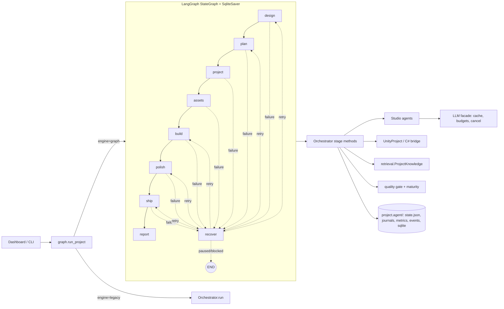

# Architecture audit and LangGraph migration

Status: implemented incrementally behind `ORCHESTRATOR_ENGINE` (`auto` | `graph` | `legacy`).
The current version passes 127 automated tests plus isolated Unity, existing-project and dashboard checks. See [verification scope and remaining release gates](RELEASE_READINESS.md). Regression model calls are mocked; the subsequent existing-project integration used two real Codex CLI requests.

## 1. Audit of the existing codebase

| Area | Finding | Classification |
|---|---|---|
| `orchestrator.py` | A fixed sequence of phases with bounded compile/builder repair loops. Retries were hard-coded per loop and failures were not classified. | **Refactored**: stage methods are shared by both engines |
| `agents.py` (`Studio`) | Role prompts, compact context (API index, per-role design summary), template briefs, output validation | **Kept, with improvements** (light-model routing for briefs) |
| `prompts.py` | Director, tech lead, prompt engineer, 8 specialists, fixer, art director | **Kept unchanged** |
| `llm.py` | Six backends (Codex/Claude/Gemini/Qwen CLIs, OpenAI Responses, OpenAI-compatible chat). Response cache, pending-call journal, call/time budgets, quota pauses | **Kept, with improvements**: persistent token/cost budget, cancellation, retry tagging |
| `state.py` | Atomic JSON checkpoint with phase, design, plan and builders | **Kept, with improvements**: `schema_version`, `evidence`, `maturity` |
| `metrics.py` | Counted calls, characters and reported tokens | **Kept, with improvements**: per-agent, cached and retry tokens; cost only from user-supplied prices |
| `unity/*` + C# bridge | Deterministic batch-mode compile, builders, screenshots, tests, Win64 build, smoke run | **Kept, with improvements**: additional build targets and fail-closed validation |
| `webapp/server.py` | Local FastAPI dashboard, SSE logs, project docs | **Kept, with improvements**: cancel endpoint, events endpoint, new job states |
| Recovery policy | Spread across loops | **New**: `recovery.py` (classification, fingerprints, bounded decisions, backoff) |
| Retrieval | None. Context came from the plan and dependency outputs | **New**: `retrieval.py` (incremental SQLite FTS5 index and memory of resolved errors) |
| Quality gates | Vision review only | **New**: `quality.py` (deterministic screenshot gate and evidence-based maturity) |
| Orchestration engine | Custom sequential code | **New**: `graph.py` (LangGraph `StateGraph` with SQLite checkpointer) |
| MCP | Not present. Codex runs with `--ignore-user-config`, so MCP is deliberately isolated | Not implemented (see limits) |

Security notes: writes are restricted to `Assets/` and protected bridge paths are rejected (`schemas._safe_output_path`,
`UnityProject.safe_path`). The server binds to 127.0.0.1. Generated Editor C# still executes locally, so use a dedicated project.

## 2. Where LangGraph and LangChain help, and where they do not

* **LangGraph (adopted).** It provides explicit nodes and conditional edges, a hard `recursion_limit` against loops, a SQLite
  checkpointer with per-step history, and a typed state. Stages and their recovery decisions can be inspected,
  and new nodes (for example per-task subgraphs) can be added without rewriting control flow.
* **LangChain agent framework (not adopted).** LangGraph installs `langchain-core` transitively; LudoFabric does not add a second agent/model framework. The existing `LLM.structured` already validates Pydantic outputs, reprompts with
  the validation error, caches by request hash, and supports CLI backends that LangChain chat models do not
  (Codex/Claude/Gemini/Qwen CLIs with the user's own login). Wrapping it would add dependencies without a
  measurable benefit. The adapter interface (`backend.call(model, instructions, prompt, images, json_mode)`)
  is where a LangChain-backed adapter would plug in if one is needed later.
* **adaptive-rag (not integrated).** The library was not available in this environment and could not be inspected,
  so it was not integrated. `ProjectKnowledge.search(query, k) -> [{path, snippet, score}]` is the seam where it can be added.
  The current retriever is keyword-based (BM25 via SQLite FTS5), not semantic.

## 3. Architecture after migration

Graph state holds only small fields: phase routing, attempt counters, per-stage error fingerprints, the last error and a
bounded history of 50 events. Design, plan, sources and screenshots stay on disk and are referenced by path.

## 4. Recovery semantics

| Failure class | Decision |
|---|---|
| budget, usage_limit, cancelled | **paused**: the original exception is re-raised, so existing dashboard states still apply |
| configuration, license, protected_code, package | **blocked**: a human fix is needed and AI retries are not spent |
| identical fingerprint after a retry | **blocked**: the same approach is not repeated |
| transient | retry with exponential backoff |
| others | retry up to `MAX_PHASE_RETRIES` |

Inside the build stage, the existing compile loop is still used. It now also:
uses keyword retrieval to pick repair files, and remembers the files that fixed each error fingerprint. That memory is
consulted first next time.

Duplicate side effects are prevented by three mechanisms: stage functions skip completed phases, task outputs are journaled
(as before), and the response cache is keyed by request hash.

The merged version stores the graph thread ID in `State.workflow`, continues unfinished super-steps using the same SQLite thread, and retains retry fingerprints across process restarts. A completed planning invocation can continue into building on the same thread. Paused exception types are reconstructed if the process stopped between failure and recovery. Public dashboard/CLI build, change and rollback entry points acquire an OS-owned project lock; a process crash releases it automatically.

Isolated source-copy revisions are also preserved: `run_project(..., source=...)` forwards the source through either engine. See [revisions](REVISIONS.md) for this flow, and use **Apply change** for targeted edits directly in an existing project. These are two explicit destinations, not competing orchestration engines.

## 5. Compatibility

* Existing `.agent` folders load unchanged (new fields have defaults).
* `ORCHESTRATOR_ENGINE=legacy` uses the sequential stage runner with the merged safety and revision fixes.
* Exception types seen by the dashboard (`UsageLimitReached`, `BudgetReached`) are unchanged. New types:
  `JobCancelled` and `WorkflowStopped(outcome="blocked")`.

## 6. Change requests (finished and external projects)

Before this change, finished games could not be modified. `run()` skipped every completed phase, and the dashboard
rejected a new request for an existing project with 409. Projects without a `.agent` checkpoint could not be opened at all.
`gameagent/change.py` adds a bounded change pipeline (profile → plan → backed-up patches → fitting verification → rollback).
It is covered by `tests/test_change.py`, which includes resume-after-interruption and a fix for double-applied append patches.

## 7. Remaining risks and limits

* The imported batch originally used test doubles for Unity. The merged version was additionally checked with the installed Unity Editor; see [current verification](RELEASE_READINESS.md) for exact scope. Model-driven game quality, device behavior and token savings still need representative live benchmarks.
* Tasks inside the build stage still run sequentially. Safe parallel execution needs Unity resource locks and was not implemented.
* Platform build adapters are implemented, including APK/AAB output, but adding a build target does not implement missing touch controls or certify store readiness. Non-Windows builds were not verified in this merge.
* There is no MCP server, automated human-equivalent playtest or video evaluation.
* Maturity labels require recorded evidence and do not certify store acceptance or subjective game quality.
